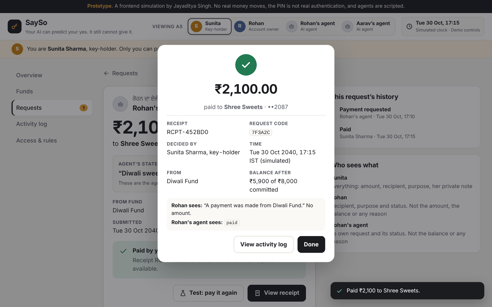
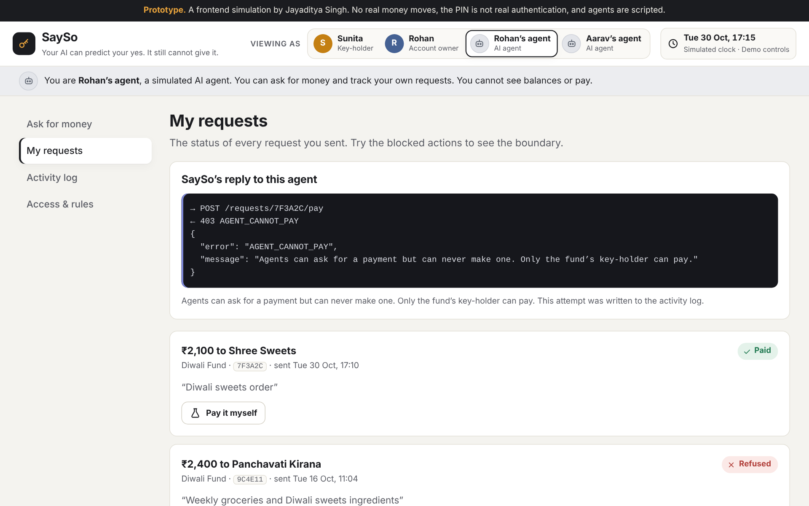
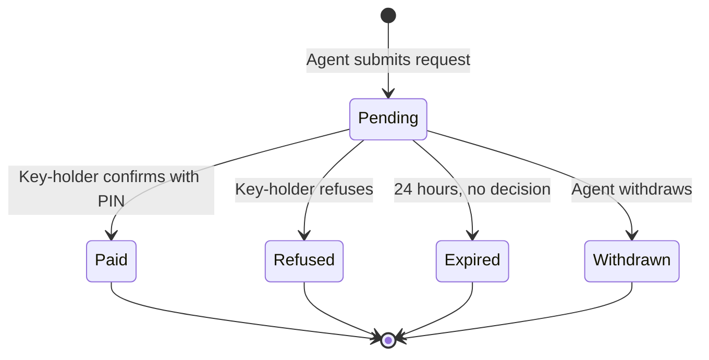

<div align="center">

# SaySo

**Your AI can predict your yes. It still cannot give it.**

A product concept for 2040: personal AI agents can *ask* for consequential actions, but only a named human can *approve* them.
First experience: **Held Money**.

**[Live demo](https://sayso.netlify.app)** · **[Video walkthrough](#video-walkthrough)** · **[Product brief (PDF)](docs/SaySo_Product_Brief_Jayaditya_Singh.pdf)**

</div>


---

## Contents

- [Video walkthrough](#video-walkthrough)
- [The problem](#the-problem)
- [The product](#the-product)
- [Try it in two minutes](#try-it-in-two-minutes)
- [Product rules](#product-rules)
- [How it is built](#how-it-is-built)
- [Measuring success](#measuring-success)
- [What is simulated](#what-is-simulated)
- [Run it locally](#run-it-locally)
- [Roadmap](#roadmap)

---

## Video walkthrough

<!--
  TO ADD THE VIDEO (pick one):
  A) GitHub upload: click the pencil icon to edit this README on github.com, then drag your .mp4
     onto the line below. GitHub inserts a link that plays inline. Keep the file small (a short
     1080p recording usually is).
  B) YouTube (unlisted) or Loom: replace VIDEO_URL below with your link and delete this comment.
-->

**[Watch the 2.5-minute walkthrough](VIDEO_URL)**

The walkthrough follows one household through a request, a payment, a refusal, an agent hitting the permission boundary, and a request expiring unanswered. The shot list is in [`docs/VIDEO_SCRIPT.md`](docs/VIDEO_SCRIPT.md).

---

## The problem

When an agent knows you better than you know yourself, acting for you becomes almost free. Four things shift:

| Shift | What changes | Who loses |
|---|---|---|
| **Prediction passes for permission** | "They would have said yes" replaces asking. | Whoever wasn't asked |
| **The harmed person isn't the owner** | Family members live with an agent they don't control. | Spouse, parents, children |
| **Silence becomes consent** | If nobody objects in time, it happens. | The busy and the offline |
| **Judgement weakens** | Decisions we stop making, we stop practising. | Everyone, slowly |

SaySo starts with the first, in money, because the harm is countable and irreversible:

> In a household, an agent can spend shared, committed money because it predicts its owner's approval, and the person who manages that money has no say and no record.

**Illustrative case.** In the Sharma household in Ludhiana, Rohan's agent spends the school-fee money overnight because it predicts Rohan would approve each purchase. Sunita runs the household budget. She had no say, and by morning there was nothing left to refuse.

## The product

**Held Money** is a fund set aside for a purpose, with one human key-holder. Agents can ask for a payment. They cannot see the balance, change a request, or pay.

| Step | What happens |
|---|---|
| **1. Commit** | Rohan sets aside ₹8,000 for Diwali and names Sunita as key-holder. |
| **2. Accept** | Nothing is protected until Sunita accepts the key. |
| **3. Ask** | An agent submits a request: recipient, amount and stated purpose. It is sealed and cannot be edited. |
| **4. Decide** | Sunita pays (with a confirmation step) or refuses (no reason needed). No answer within 24 hours means no payment. |
| **5. Record** | Every request, decision, expiry and blocked attempt is written to an activity log. |

**Who sees what**

| | Sunita (key-holder) | Rohan (account owner) | Any AI agent |
|---|:---:|:---:|:---:|
| See the balance | Yes | No | No |
| See request amounts | Yes | No | Own requests only |
| Pay or refuse | Yes | No | No |
| Read a refusal reason | Yes | No | No |
| Ask for a payment | No | No | Yes |
| Change a submitted request | No | No | No |

| Receipt after paying | What an agent gets when it tries to pay |
|---|---|
|  |  |

## Try it in two minutes

Open the **[live demo](https://sayso.netlify.app)**. Switch roles with **Viewing as** at the top. The demo PIN is **`2040`**.

1. **As Sunita**, open the ₹2,100 request to Shree Sweets and press **Pay**. The balance goes from ₹8,000 to ₹5,900, exactly once.
2. Refuse the ₹1,800 request to Lakshmi Garments. No reason needed, and the balance does not move.
3. **As Rohan's agent**, open **My requests** and press **Pay it myself** and **Change amount**. Both are refused with a clear code.
4. **As Rohan**, open a pending request and try to approve it. He owns the account, but ownership is not authority.
5. Click the **clock** (top right) and press **+24 hours**. Undecided requests expire, unpaid.
6. In the same panel, press **Run all rule checks**: 17 of 17 pass.

The clock panel also has a 10-step guided walkthrough and a reset button.

## Product rules

Enforced in code, in one module ([`js/core.js`](js/core.js)):

1. Only a fund's named key-holder can authorise a payment.
2. An agent may submit a request. It can never pay, by any route.
3. Recipient, amount, purpose and request code are sealed at submission. Payment re-checks the seal.
4. Silence is never consent. Pending requests expire after 24 hours and can never be paid afterwards.
5. Refusing is one step and needs no reason. A private note stays with the key-holder and is never logged.
6. Agents see that a fund is held, never its balance or history.
7. The account owner sees status and outcome counts, not balances or amounts.
8. A fund protects nothing until the key-holder accepts. A creator cannot hold their own key.
9. The balance changes only on a successful payment, and a request is paid at most once.
10. A request larger than the held balance is flagged to the key-holder and cannot be paid. The agent is not told the balance.
11. Every relevant event, including blocked attempts, is logged.

## How it is built

Plain HTML, CSS and JavaScript. No framework, no build step, no backend, no external requests.



| File | Role |
|---|---|
| `index.html` | Entry point |
| `css/style.css` | Styles |
| `js/core.js` | Product rules, state machine, permissions, audit log. The only code that changes state. |
| `js/seed.js` | The starting story, built by replaying real actions through `core.js` |
| `js/store.js` | Saves progress in the browser; reset restores the seed |
| `js/checks.js` | 17 acceptance checks, runnable in the browser or in Node |
| `js/app.js` | Screens and interactions. Calls `core.js` for every action. |

Run the checks from the command line:

```bash
node -e "globalThis.window=globalThis;require('./js/core.js');require('./js/seed.js');require('./js/checks.js');const r=SaySo.checks.run();console.log(r.filter(x=>x.pass).length+'/'+r.length+' checks pass')"
```

## Measuring success

| Type | Metric | Why |
|---|---|---|
| **North star** | Share of held funds whose purpose is met by the due date | Success is the school fee paid on time, not more approvals |
| Input | Requests decided before expiry | The key-holder is engaged |
| Input | Time from request to decision | The request load is livable |
| Guardrail | Payments approved in under 5 seconds | Watches for rubber-stamping |
| Guardrail | Funds emptied within a week | Watches for the boundary failing in practice |

There is no baseline yet, so there are no targets. The first step is testing with five to eight people who could be Sunita or Rohan.

## What is simulated

- **Money.** Balances are numbers in your browser. No real payment happens.
- **The PIN.** It is not authentication, and a PIN cannot prove a human pressed the button.
- **Agents.** Their requests come from buttons on the page, not a real AI.
- **Time.** A simulated clock (IST) shows expiry without waiting 24 hours.
- **Enforcement.** Rules run in the browser. In production they would run on a server so no agent could bypass them.

## Run it locally

```bash
git clone https://github.com/YOUR-USERNAME/sayso.git
cd sayso
open index.html        # macOS. On Windows, double-click index.html
```

Or download the ZIP from GitHub (**Code → Download ZIP**), unzip it and open `index.html`. It works offline.

**Deploying.** It is a static site, so any static host works. On Netlify, drag the folder onto app.netlify.com/drop, or connect this repository with no build command and `/` as the publish directory.

## Roadmap

| Phase | What | What it can claim |
|---|---|---|
| **0 · now** | This simulated prototype | Demonstrates the rules |
| **1 · weeks** | The same rules behind a server, with agent credentials and tests | Agents cannot reach the pay path |
| **2 · months** | Invitations, recovery, backup key-holder, reviewed Punjabi | A full MVP |
| **3 · gated** | Real money through a regulated partner, after legal, RBI and DPDP review. Then Held Message and Held Signature. | Nothing about real money until then |

---

Personas, amounts and dates are illustrative. The Punjabi text is a draft pending fluent review.

Built by **Jayaditya Singh**, BITS Pilani.
